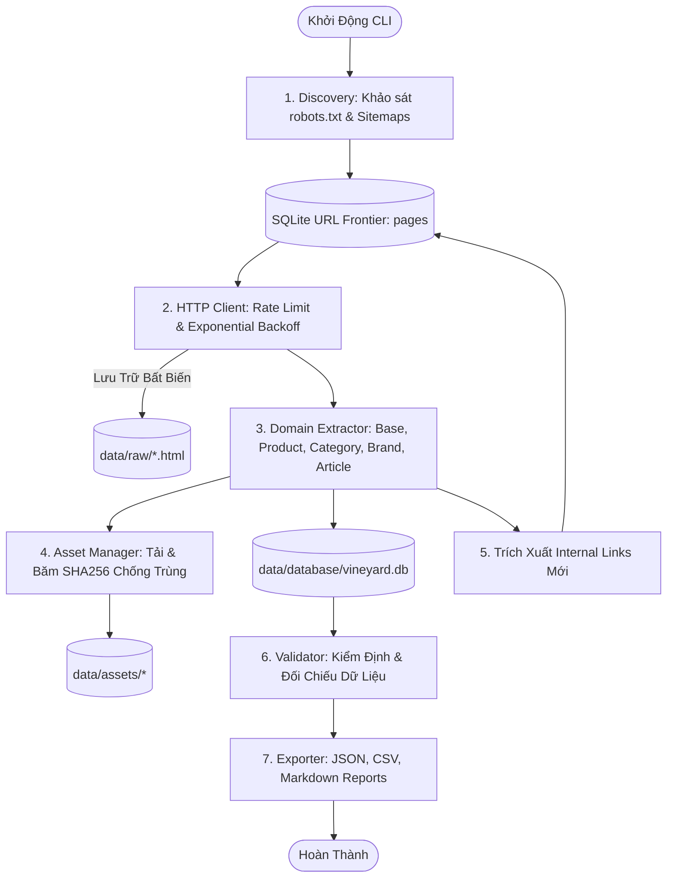

# HƯỚNG DẪN VẬN HÀNH CRAWLER (CRAWLER GUIDE)

## 1. Giới Thiệu
Crawler VINEYARD 2.0 được xây dựng bằng Python 3.12, áp dụng mô hình kiến trúc Pipeline bất đồng bộ kết hợp HTTPClient kiểm soát tốc độ (polite rate limiting), cơ chế phục hồi khi gặp lỗi (exponential backoff & retry), và chống trùng lặp tài nguyên (deduplication via SHA256).

---

## 2. Kiến Trúc Luồng Thu Thập



---

## 3. Các Lệnh CLI & Tham Số

### 3.1. Khảo Sát Sơ Bộ (`--discover-only`)
Kiểm tra tính hợp lệ của domain, luật truy cập trong `robots.txt`, phân tích sơ đồ trang `sitemap.xml` và lập danh mục URL ban đầu:
```bash
python -m crawler.cli --discover-only
```

### 3.2. Thu Thập Thử Nghiệm Có Giới Hạn (`--limit N`)
Chạy trích xuất N URL đầu tiên trong hàng đợi để kiểm chứng logic trích xuất của Extractor và tải ảnh mẫu:
```bash
python -m crawler.cli --limit 10
```

### 3.3. Tiếp Tục Từ Checkpoint (`--resume`)
Nếu tiến trình crawl bị gián đoạn do mất mạng hoặc tắt máy, lệnh resume sẽ tự động đọc các URL có trạng thái `pending` trong SQLite mà không crawl lại các trang đã thành công:
```bash
python -m crawler.cli --resume --limit 50
```

### 3.4. Thu Thập Toàn Bộ (`--full`)
Chạy toàn bộ chu trình khép kín: Discovery -> Full Crawl -> Visual Audit -> Validation -> Export:
```bash
python -m crawler.cli --full
```

### 3.5. Chụp Ảnh Màn Hình Đa Thiết Bị (`--screenshot`)
Sử dụng Playwright Chromium để render và chụp ảnh toàn trang tại 3 độ phân giải chuẩn:
- **Desktop**: 1440 x 900
- **Tablet**: 768 x 1024
- **Mobile**: 390 x 844
```bash
python -m crawler.cli --screenshot
```

### 3.6. Kiểm Định Tính Toàn Vẹn (`--validate`)
Phân tích tỷ lệ hoàn thành (completeness rate), phát hiện SKU trùng lặp, giá rỗng, ảnh lỗi:
```bash
python -m crawler.cli --validate
```

### 3.7. Xuất Dữ Liệu & Báo Cáo (`--export`)
Tạo các tệp JSON, CSV chuẩn hóa và tài liệu Markdown:
```bash
python -m crawler.cli --export
```

---

## 4. Cơ Chế Xử Lý Lỗi & Giới Hạn Tốc Độ (Rate Limiting)
- **Độ trễ tối thiểu**: `1.5 giây` giữa mỗi request đến domain nguồn.
- **HTTP 429 (Too Many Requests)**: Đọc header `Retry-After`, tạm dừng theo yêu cầu của server.
- **HTTP 5xx / Network Timeout**: Tự động thử lại tối đa 3 lần với thời gian chờ cấp số nhân ($2s \rightarrow 4s \rightarrow 8s$).
- **Ghi nhận lỗi**: Toàn bộ lỗi được lưu chi tiết vào bảng `extraction_errors` gồm: URL, pha lỗi (fetch/extraction/asset), kiểu lỗi (Timeout, ParseError...) và thông báo lỗi.
