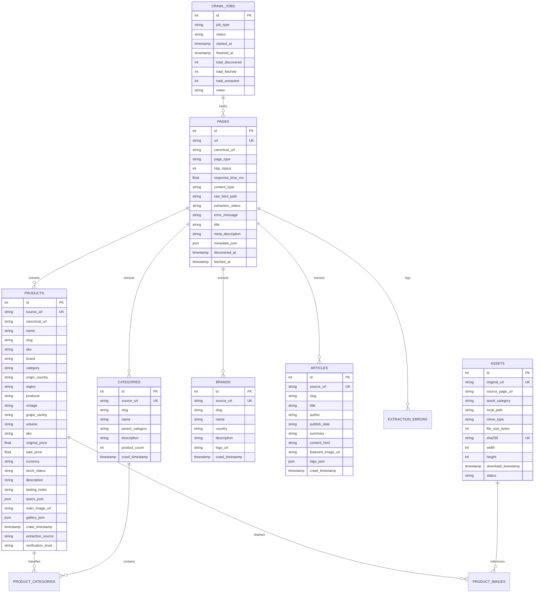

# VINEYARD 2.0 - DATA SCHEMA & ARCHITECTURE SPECIFICATION

## 1. Triết Lý Thiết Kế Dữ Liệu
Hệ thống lưu trữ của VINEYARD 2.0 tuân thủ mô hình **Dual-Layer Storage**:
1. **Raw Snapshot Layer (`data/raw/`)**: Giữ nguyên vẹn 100% HTML response từ máy chủ nguồn kèm timestamp và SHA256 để đảm bảo tính bất biến và truy xuất nguồn gốc (Provenance).
2. **Normalized Relational Layer (`data/database/vineyard.db`)**: Chuẩn hóa thành các bảng quan hệ trong SQLite, có ràng buộc khóa ngoại (`FOREIGN KEY`), khóa duy nhất (`UNIQUE`), chỉ mục (`INDEX`) và lưu trữ JSON specs linh hoạt.
3. **Asset Vault Layer (`data/assets/`)**: Lưu trữ hình ảnh và phương tiện truyền thông đã loại bỏ trùng lặp dựa trên băm mật mã SHA256.

---

## 2. Sơ Đồ Thực Thể Quan Hệ (Entity-Relationship Diagram)



---

## 3. Đặc Tả Chi Tiết Các Trường (Fields Specification)

### Bảng `products` (Sản Phẩm Rượu Vang & Rượu Mạnh)
| Cột | Kiểu Dữ Liệu | Ràng Buộc | Ý Nghĩa / Nguồn Trích Xuất |
|---|---|---|---|
| `id` | `INTEGER` | `PRIMARY KEY AUTOINCREMENT` | Khóa chính |
| `source_url` | `TEXT` | `UNIQUE NOT NULL` | URL trang sản phẩm gốc |
| `canonical_url` | `TEXT` | | Canonical URL chuẩn hóa |
| `name` | `TEXT` | `NOT NULL` | Tên đầy đủ của sản phẩm rượu |
| `slug` | `TEXT` | `NOT NULL` | URL slug thân thiện SEO |
| `sku` | `TEXT` | | Mã định danh quản lý kho hàng (`B06.GRATI.06`) |
| `brand` | `TEXT` | | Thương hiệu rượu (`Reputazione`, `Auswan Creek`...) |
| `category` | `TEXT` | | Phân cấp danh mục (VD: `Vang Đỏ > Vang Ý`) |
| `origin_country` | `TEXT` | | Quốc gia xuất xứ (`Ý`, `Pháp`, `Chile`, `Úc`...) |
| `region` | `TEXT` | | Vùng làm rượu vang (`Puglia`, `Bordeaux`, `Tuscany`...) |
| `producer` | `TEXT` | | Tên nhà làm rượu / Hãng sản xuất |
| `vintage` | `TEXT` | | Niên vụ thu hoạch nho (`2015`, `2018`, `2020`...) |
| `grape_variety` | `TEXT` | | Giống nho (`Primitivo`, `Cabernet Sauvignon`...) |
| `volume` | `TEXT` | | Dung tích đóng chai (`0.75L`, `3L`, `750ml`...) |
| `abv` | `TEXT` | | Nồng độ cồn (% ABV, VD: `19,0%`, `14.5%`) |
| `original_price`| `REAL` | | Giá niêm yết trước giảm giá (VND) |
| `sale_price` | `REAL` | | Giá bán thực tế (VND, `null` nếu "Liên hệ") |
| `currency` | `TEXT` | `DEFAULT 'VND'` | Đơn vị tiền tệ |
| `stock_status` | `TEXT` | | Tình trạng (`Còn trong kho`, `Hết hàng`, `Liên hệ`) |
| `description` | `TEXT` | | Mô tả tổng quan sản phẩm |
| `tasting_notes`| `TEXT` | | Ghi chú nếm thử (Màu sắc, hương thơm, vị vòm miệng) |
| `specs_json` | `TEXT` | | Thuộc tính mở rộng dạng JSON |
| `main_image_url`| `TEXT` | | URL ảnh đại diện chất lượng cao |
| `gallery_json` | `TEXT` | | Danh sách các ảnh chi tiết phụ |
| `crawl_timestamp`| `TIMESTAMP` | `NOT NULL` | Thời điểm thu thập theo chuẩn ISO 8601 UTC |
| `verification_level`| `TEXT` | `DEFAULT 'verified'` | Mức độ xác thực (`verified`, `partial`, `unverified`) |

---

## 4. Ánh Xạ Sang TypeScript Model Cho Next.js Frontend
```typescript
export interface WineProduct {
  id: number;
  sourceUrl: string;
  canonicalUrl?: string;
  name: string;
  slug: string;
  sku?: string;
  brand?: string;
  category?: string;
  originCountry?: string;
  region?: string;
  producer?: string;
  vintage?: string;
  grapeVariety?: string;
  volume?: string;
  abv?: string;
  originalPrice?: number;
  salePrice?: number;
  currency: string;
  stockStatus: "Còn trong kho" | "Hết hàng" | "Liên hệ";
  description?: string;
  tastingNotes?: string;
  specs: Record<string, string>;
  mainImageUrl?: string;
  galleryImageUrls: string[];
  crawlTimestamp: string;
  verificationLevel: "verified" | "partial" | "unverified";
}
```
