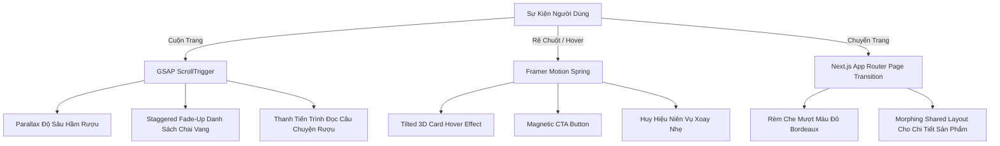

# ĐÁNH GIÁ CHUYỂN ĐỘNG & HIỆU ỨNG TƯƠNG TÁC (ANIMATION AUDIT)

## 1. Hiện Trạng Chuyển Động Website Nguồn (Legacy Animation Audit)
Khảo sát mã nguồn CSS và JavaScript của `https://vineyard.vn/`:
- **Chuyển tiếp CSS cơ bản**: Sử dụng thuộc tính `transition: all 0.3s ease` trên một số thẻ nút bấm và hover liên kết cơ bản.
- **Slider / Carousel**: Sử dụng thư viện Owl Carousel hoặc Slick Carousel jQuery cổ điển để chuyển slide banner trang chủ.
- **Hiệu ứng cuộn trang (Scroll Experience)**: Hoàn toàn tĩnh, không có ScrollTrigger, không có hiệu ứng Parallax hầm rượu hoặc Staggered Reveal khi các thẻ sản phẩm đi vào khung nhìn (Viewport).
- **Phản hồi tương tác (Micro-interactions)**: Chưa có phản hồi xúc giác hoặc hiệu ứng thêm vào giỏ hàng tinh tế (Floating cart bubble, Ripple effect, Success tick).

---

## 2. Chiến Lược Chuyển Động Xa Xỉ Cho VINEYARD 2.0 (Framer Motion & GSAP Architecture)

Chuyển động trong giao diện hàng xa xỉ (Luxury Motion) cần tuân thủ nguyên tắc: **Đĩnh đạc, mượt mà, trọng lượng thực tế (Weight & Inertia), không giật cục, không lạm dụng**.

### 2.1. Hiệu Ứng Hero Section: "The Cellar Revelation"
- **Thời lượng**: 1.2s
- **Easing**: `cubic-bezier(0.16, 1, 0.3, 1)` (Custom Apple/Luxury Luxury Ease).
- **Kịch bản**: 
  1. Nền mờ dần từ bóng tối hầm rượu `#0A0708`.
  2. Dòng chữ tiêu đề bằng phông Cinzel xuất hiện theo kiểu Text Split Reveal (từng từ nổi lên với khoảng mờ dần).
  3. Chai rượu vang chủ đạo trượt nhẹ từ dưới lên kèm hiệu ứng phản chiếu ánh sáng vàng champagne lướt qua thân chai.

### 2.2. Hiệu Ứng Thẻ Sản Phẩm (Interactive Wine Card 3D Spring)
- Khi người dùng rê chuột qua chai vang:
  - Sử dụng Framer Motion `useMotionValue` và `useTransform` tạo độ nghiêng 3D tinh tế (tối đa `8 độ`) theo vị trí con trỏ chuột.
  - Nhãn chai rượu vang có lớp phản quang (Gloss Shine Overlay) di chuyển theo góc nghiêng, tạo cảm giác như đang cầm chai vang thực tế trên tay dưới ánh đèn showroom.

### 2.3. Hiệu Ứng Trực Quan Hóa Vòm Miệng (Flavor Radar Animation)
- Khi cuộn đến phần Tasting Notes của chai vang:
  - Biểu đồ radar hoặc các thanh đo (Body, Tannin, Acidity, Sweetness) tự động lấp đầy từ 0% đến giá trị định mức với hiệu ứng sóng nước nhấp nhô nhẹ mô phỏng chất lỏng rượu vang sánh mịn.

### 2.4. Hiệu Ứng Thêm Vào Giỏ Hàng (Slide-Over Drawer & Flying Cork)
- Khi bấm "Chọn Mua" hoặc "Thêm Vào Giỏ":
  - Một đốm sáng nhỏ mô phỏng nút bần trượt mượt mà về phía biểu tượng giỏ hàng trên Header.
  - Biểu tượng giỏ hàng nảy nhẹ (scale `1.15` rồi về `1.0`).
  - Drawer giỏ hàng trượt ra êm ái từ mép phải với hiệu ứng làm mờ nền (Backdrop Blur `12px`).
