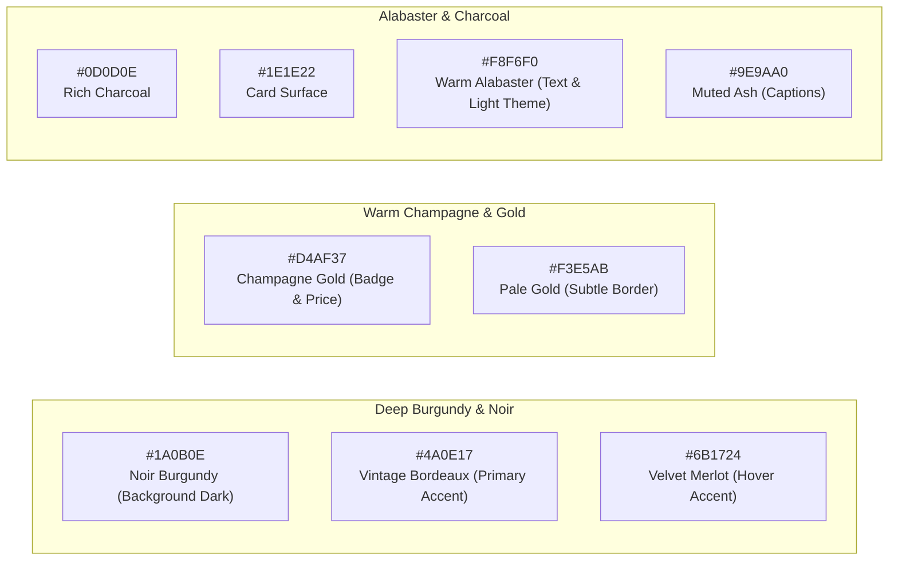

# VINEYARD DESIGN SYSTEM SPECIFICATION (V1 AUDIT & V2 UPGRADE)

## 1. Triết Lý Thiết Kế Thương Hiệu (Brand Identity & Luxury Tone)
Thương hiệu **VINEYARD** định vị trong phân khúc rượu vang nhập khẩu cao cấp (Grand Cru Classé, DOC/DOCG, Icon Wines từ Ý, Pháp, Chile, Úc).
- **Vibe & Atmosphere**: Trầm ấm, sang trọng, tinh tế như một hầm rượu vang cổ điển (Wine Cellar) kết hợp đường nét tối giản của kiến trúc đương đại.
- **Mục tiêu V2.0**: Chuyển đổi từ giao diện web PHP truyền thống sang chuẩn giao diện E-Commerce xa xỉ (Luxury Editorial Commerce), lấy sản phẩm và câu chuyện về thổ nhưỡng (Terroir) làm trọng tâm.

---

## 2. Hệ Thống Màu Sắc (Color Palette Tokens)

### 2.1. Phân Tích Bảng Màu Hiện Tại (Legacy V1)
- Màu chủ đạo nền: `#FFFFFF` (Trắng) và `#F9F9F9` (Xám nhạt).
- Màu nhấn (Accent): `#8B1E2F` (Đỏ Bordeaux) và `#C8A251` (Vàng Gold).
- Màu chữ (Typography Text): `#333333` và `#666666`.
- Đánh giá: Độ tương phản ở mức cơ bản, chưa tạo được cảm giác chiều sâu (depth) và độ sang trọng xứng tầm chai vang nghìn đô.

### 2.2. Bảng Màu Thiết Kế Nâng Cấp (Modern V2 Palette)

| Token Name | Hex Code | HSL | Mục Đích Sử Dụng |
|---|---|---|---|
| `color-surface-base` | `#0A0708` | `340, 18%, 4%` | Nền chính của website (Luxury Dark Mode) |
| `color-surface-elevated`| `#161113` | `336, 12%, 8%` | Bề mặt thẻ sản phẩm, dropdown menu, modal |
| `color-surface-card` | `#1F171A` | `334, 13%, 11%`| Thẻ bài viết, filter sidebar, giỏ hàng slide-over |
| `color-primary` | `#5C101D` | `349, 70%, 21%`| Nút CTA chính, badge niên vụ, header underline |
| `color-primary-hover` | `#781627` | `350, 69%, 28%`| Trạng thái hover của các nút tương tác chính |
| `color-accent-gold` | `#D4AF37` | `46, 65%, 52%` | Huy hiệu giải thưởng, phân hạng DOC/Grand Cru |
| `color-text-primary` | `#FBF9F5` | `40, 43%, 97%` | Tiêu đề sản phẩm, giá bán, nội dung chính |
| `color-text-secondary`| `#A8A19F` | `13, 5%, 64%` | Ghi chú giống nho, nồng độ, dung tích, breadcrumb |
| `color-border-subtle` | `#2D2225` | `343, 14%, 15%`| Đường phân cách tinh tế giữa các khối sản phẩm |

---

## 3. Hệ Thống Kiểu Chữ (Typography Hierarchy)

### 3.1. Phông Chữ Đề Xuất (Font Pairings)
- **Display & Headings (Serif)**: `Cinzel` hoặc `Playfair Display` kết hợp `Cormorant Garamond` — Mang đậm phong cách chữ khắc trên nhãn chai rượu vang Pháp & Ý cổ điển.
- **Body & Technical Specs (Sans-Serif)**: `Plus Jakarta Sans` hoặc `Inter` — Đảm bảo khả năng đọc thông số nồng độ, dung tích, giá tiền rõ nét và chuẩn mực trên mọi màn hình.

### 3.2. Bậc Kiểu Chữ (Type Scale)
| Cấp Độ | Cỡ Chữ (Desktop) | Cỡ Chữ (Mobile) | Line Height | Phông | Trọng Lượng | Ứng Dụng |
|---|---|---|---|---|---|---|
| `display-1` | 56px (3.5rem) | 38px (2.375rem) | 1.15 | Serif | SemiBold 600 | Hero Banner Trang Chủ |
| `h1` | 40px (2.5rem) | 30px (1.875rem) | 1.2 | Serif | Medium 500 | Tên Sản Phẩm Trang Chi Tiết |
| `h2` | 32px (2rem) | 24px (1.5rem) | 1.25 | Serif | Medium 500 | Tiêu Đề Danh Mục, Vùng Làm Rượu |
| `h3` | 24px (1.5rem) | 20px (1.25rem) | 1.3 | Serif | SemiBold 600 | Thẻ Sản Phẩm Nổi Bật |
| `body-large`| 18px (1.125rem) | 16px (1rem) | 1.6 | Sans | Regular 400 | Lời Mở Đầu Mô Tả Rượu Vang |
| `body` | 15px (0.938rem) | 14px (0.875rem) | 1.5 | Sans | Regular 400 | Đoạn Văn Thường, Tasting Notes |
| `caption` | 12px (0.75rem) | 11px (0.688rem) | 1.4 | Sans | Medium 500 | SKU, Dung Tích, Phân Hạng |

---

## 4. Hệ Thống Khoảng Cách & Lưới (Spacing & Grid)
- **Grid Layout**: 12 cột chuẩn, Max Width `1380px` căn giữa.
- **Gutter**: `32px` trên Desktop, `20px` trên Tablet, `16px` trên Mobile.
- **Thang Khoảng Cách (4px Baseline)**:
  - `space-1`: 4px | `space-2`: 8px | `space-3`: 12px | `space-4`: 16px
  - `space-6`: 24px | `space-8`: 32px | `space-12`: 48px | `space-16`: 64px | `space-24`: 96px

---

## 5. Thư Viện Thành Phần UI Cốt Lõi (Core UI Components)

### 5.1. Thẻ Sản Phẩm (Wine Product Card)
- **Tỉ lệ khung ảnh chai**: `3:4` với hiệu ứng zoom nhẹ (scale 1.05) khi hover.
- **Huy hiệu nổi bật**: Nhỏ gọn ở góc trên bên trái (VD: `Italy - Puglia`, `19% ABV`).
- **Nút tương tác nhanh**: "Thêm vào giỏ" / "Chi tiết" trượt mượt mà từ đáy thẻ khi hover.
- **Thông số kỹ thuật mini**: Hiển thị Giống nho & Vùng ngay dưới tên sản phẩm.

### 5.2. Nhãn Thuộc Tính Thưởng Thức (Tasting Tags & Aroma Badges)
- Huy hiệu hình tròn hoặc bo góc mềm mại:
  - 🍷 **Màu rượu**: Đỏ Ruby, Vàng Rơm, Hồng San Hô.
  - 🍇 **Giống nho**: Primitivo, Cabernet Sauvignon, Merlot.
  - 🌡️ **Nhiệt độ phục vụ**: 16°C – 18°C.
  - 🥩 **Món ăn kết hợp**: Thịt bò nướng, Phô mai ủ lâu năm, Mì Ý sốt bò băm.
