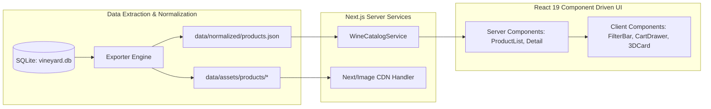

# CHIẾN LƯỢC TÁI THIẾT KẾ & HIỆN ĐẠI HÓA WEBSITE (REDESIGN STRATEGY)

## 1. Tầm Nhìn Kiến Trúc Kỹ Thuật (Architecture Vision)
Dự án **VINEYARD 2.0** chuyển dịch toàn bộ hệ sinh thái từ nền tảng Monolith PHP cổ điển sang kiến trúc **Headless & Component-Driven Web Application**:
- **Framework**: **Next.js 15 (App Router)** với React Server Components (RSC) để tối ưu hóa SEO tốc độ tải trang tuyệt đối.
- **Ngôn ngữ**: **TypeScript** nghiêm ngặt (Strict Type Safety), loại bỏ rủi ro runtime error.
- **Styling**: **Tailwind CSS v4** với cấu hình Custom Design Tokens, kết hợp CSS Modules khi cần xử lý animation chuyên sâu.
- **Motion Engine**: **Framer Motion** cho micro-interactions và UI state transitions; **GSAP ScrollTrigger** cho các trải nghiệm cuộn điện ảnh (Cinematic Scroll Stories).
- **Trạng thái giỏ hàng & bộ lọc**: **Zustand** siêu nhẹ, lưu trữ client-side (LocalStorage) với mô phỏng luồng đặt hàng thanh lịch (Mock Checkout / Sommelier Inquiries).

---

## 2. Kiến Trúc Phân Tách Dữ Liệu Khỏi Giao Diện (Data Decoupling Architecture)

---

## 3. Kế Hoạch Triển Khai Chi Tiết Các Nhóm Trang

### 3.1. Trang Chủ (Homepage - `/`)
- **Hero Showcase**: Trình chiếu chai vang biểu tượng (Icon Wine) của tháng với video nền hầm rượu hoặc chuyển động Parallax nhẹ.
- **Curated Collections**: Phân nhóm trực quan theo 4 nhu cầu lớn của khách hàng:
  1. *Rượu Vang Đỏ Đậm Đà (Full-Bodied Reds)*: Dành cho bữa tối thịt bò, tiệc tùng.
  2. *Rượu Vang Trắng Tươi Mát & Vang Nổ (Crisp Whites & Champagne)*: Khai vị, hải sản.
  3. *Hộp Quà Doanh Nghiệp & Bộ Sưu Tập Giới Hạn (Limited Editions & Gift Boxes)*.
  4. *Rượu Vang Theo Quốc Gia (Pháp, Ý, Chile, Úc, Tây Ban Nha)*.
- **Sommelier's Pick**: Lời khuyên từ chuyên gia thử nếm rượu vang hàng đầu.
- **Trust & Origin Assurance**: Huy hiệu cam kết 100% nhập khẩu chính ngạch nguyên chai, bảo quản nhiệt độ chuẩn $16^\circ\text{C}-18^\circ\text{C}$ 24/7.

### 3.2. Trang Danh Mục & Bộ Lọc Nâng Cao (Category / Collection - `/danh-muc/[slug]`)
- **Bộ lọc đa tiêu chí (Faceted Filtering)**:
  - Quốc gia (Pháp, Ý, Chile, Úc...)
  - Giống nho (Cabernet Sauvignon, Merlot, Primitivo, Syrah...)
  - Mức giá (Dưới 1 triệu, 1-3 triệu, 3-5 triệu, Trên 5 triệu, Giá liên hệ)
  - Nồng độ cồn ($< 13\%$, $13\% - 14.5\%$, $> 15\%$)
  - Dung tích ($750\text{ml}$, $1500\text{ml}$ Magnum, $3\text{L}$, $5\text{L}$)
- **Chế độ hiển thị linh hoạt**: Chuyển đổi giữa Grid View (xem ảnh lớn) và Sommelier List View (xem kèm bảng nếm thử tóm tắt).

### 3.3. Trang Chi Tiết Sản Phẩm (Product Detail Page - `/san-pham/[slug]`)
- **Cấu trúc 2 cột tỷ lệ vàng**:
  - Cột trái (Sticky): Gallery ảnh chai rượu vang độ phân giải cao, hỗ trợ zoom nhãn chai để kiểm tra năm sản xuất và con dấu chứng nhận xuất xứ.
  - Cột phải: Tên sản phẩm sang trọng, SKU, huy hiệu nồng độ và xuất xứ, giá niêm yết, nút "Thêm vào giỏ" / "Yêu cầu Sommelier tư vấn trực tiếp".
- **Khối thông số độc quyền (The Terroir & Craft Specs)**:
  - Bảng thông số: Nhà làm rượu, Vùng, Niên vụ, Loại nút chai, Phân hạng DOC/DOCG.
  - Hương vị & Món ăn kết hợp: Trực quan hóa vòm miệng bằng thanh đo Tannin, Body, Acidity.
- **Gợi ý sản phẩm tương thích (Pairings & Recommendations)**:
  - Ly uống rượu vang phù hợp với dòng vang này (Bordeaux glass, Burgundy glass).
  - Phụ kiện bình thở rượu (Decanter) và đồ khui mở vang chuyên dụng.

### 3.4. Giỏ Hàng & Mô Phỏng Đặt Hàng (Cart & Sommelier Consultation)
- **Quy tắc an toàn**: Không tích hợp cổng thanh toán trực tiếp hay trừ tiền thật khi chưa có ủy quyền pháp lý từ chủ sở hữu.
- **Luồng trải nghiệm V2.0**:
  - Giỏ hàng trượt (Slide-over Cart) lưu trữ danh sách các chai vang người dùng quan tâm.
  - Nút *"Gửi Yêu Cầu Đặt Rượu & Nhận Tư Vấn"* mở form nhập: Họ tên, Số điện thoại/Zalo, Địa chỉ giao hàng và ghi chú (yêu cầu ướp lạnh sẵn, đóng hộp quà tặng).
  - Hiển thị thông báo xác nhận thành công và mã đơn khảo sát.

---

## 4. Chiến Lược Nội Dung & Bản Quyền Hình Ảnh (Content & Asset Integrity)
1. **Bảo tồn dữ liệu gốc**: Giữ nguyên tên gốc, mã SKU, hãng sản xuất từ website nguồn, không tự ý chỉnh sửa thông số kỹ thuật.
2. **Quyền sở hữu tài sản truyền thông**: Mọi hình ảnh chụp sản phẩm được lưu trữ phục vụ mục đích nghiên cứu, đối chiếu và chuẩn hóa catalog cục bộ. Khi phát hành chính thức, website sẽ sử dụng ảnh chụp sản phẩm studio có bản quyền của doanh nghiệp.
